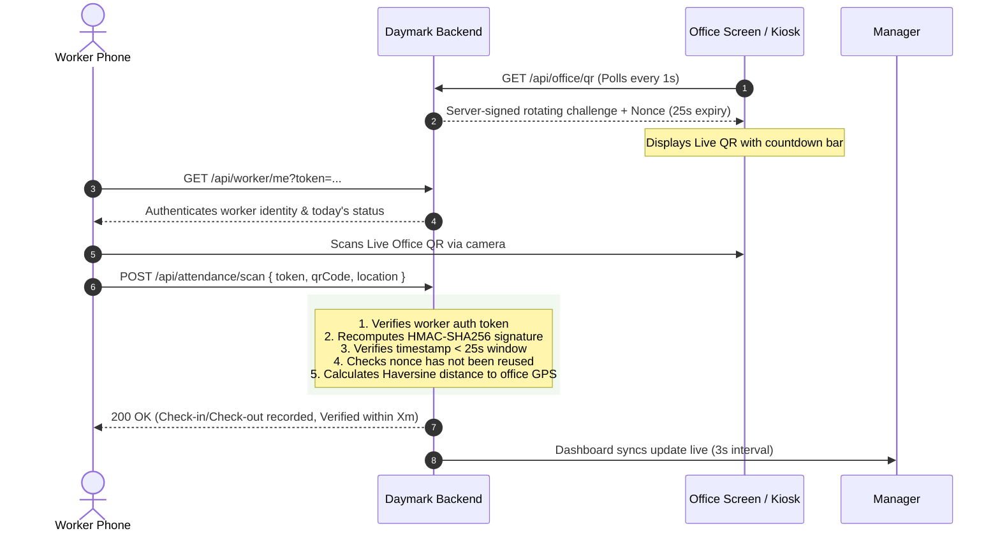

# Daymark QR Attendance System

A full-stack, real-time office attendance system with **server-signed rotating QR challenges**, **token-authenticated worker links**, **anti-replay tracking**, and **GPS office proximity geofencing**.

[](https://dashboard.render.com/blueprints/new?repo=https://github.com/sreyaskrishna87/daymark-qr-attendance)
[](https://railway.app/template/github?template=https://github.com/sreyaskrishna87/daymark-qr-attendance)

---

## 🚀 1-Click Real Cloud Deployment (Free Public HTTPS URL)

Your complete codebase has been pushed to GitHub:  
**Repository:** [https://github.com/sreyaskrishna87/daymark-qr-attendance](https://github.com/sreyaskrishna87/daymark-qr-attendance)

### Option 1: Deploy to Render (Recommended — 100% Free)
1. Click the button above or open: **[Render Blueprint Deploy](https://dashboard.render.com/blueprints/new?repo=https://github.com/sreyaskrishna87/daymark-qr-attendance)**
2. Sign in with GitHub (`sreyaskrishna87`).
3. Click **Apply Blueprint** (Render automatically reads `render.yaml`, installs dependencies, configures environment variables, and launches the app).
4. In ~60 seconds, you get a live public HTTPS URL:  
   `https://daymark-qr-attendance.onrender.com`

### Option 2: Deploy to Railway
1. Open [railway.app](https://railway.app) and click **New Project** → **Deploy from GitHub repo**.
2. Select `sreyaskrishna87/daymark-qr-attendance`.
3. Railway automatically detects `railway.json` and spins up the live container with a free `.up.railway.app` HTTPS domain.

---

## 1. Static Preview Hosting (Client-Only Demo)

If you only want a quick frontend mockup without shared server synchronization:
- Deploy the `dist/` directory to any static hosting provider such as **Netlify**, **Cloudflare Pages**, or **Vercel**.
- **Publish directory:** `dist`
- **Entry file:** `dist/index.html`

> ⚠️ **Limitation of Static Hosting:**  
> Static hosting alone stores attendance and worker lists strictly inside each browser's local storage. Workers scanning on their individual smartphones will **not** sync records to the manager's dashboard, and rotating challenges cannot be cryptographically signed against fake or replayed scans. For real attendance, run the backend below.

---

## 2. Real Attendance Tracking (Production Backend)

To enable live synchronization across all devices and securely prevent fake scans, the included Node.js + Express + SQLite backend fulfills the four core requirements:

| Requirement | Implementation Detail |
| :--- | :--- |
| **Authenticated Personal Link** | Each worker receives a unique URL containing a 160-bit cryptographic token (`/?token=<auth_token>`). No password required; bookmarked directly on the worker's home screen. |
| **Server-Signed Office QR** | The office display rotates every **25 seconds** with a signed HMAC-SHA256 payload (`DAYMARK\|V2\|officeId\|bucket\|expiresAt\|nonce\|signature`). Printed or photographed QR codes expire immediately. |
| **Central Check-in & Check-out** | All attendance scans are stored in a central SQLite database (`attendance.db`). The manager's live dashboard automatically refreshes and synchronizes stats, rosters, and activity logs across all phones and tablets. |
| **Anti-Replay & Office Proximity** | Each QR challenge includes a unique cryptographic `nonce` that can only be consumed once. The server validates phone GPS coordinates against configured office coordinates and geofence radius. |

---

## 3. Quick Start (Run Locally)

### Prerequisites
- Node.js v18 or higher (v20+ recommended)
- npm

### Installation & Launch

```bash
# 1. Navigate to the project folder
cd outputs/worker-attendance

# 2. Install dependencies
npm install

# 3. Start the attendance server
npm start
```

The server will initialize SQLite and start listening on **http://localhost:3000**.

### Key URLs

- **Manager Dashboard:** [http://localhost:3000/](http://localhost:3000/)  
  *Add workers, copy personal check-in links, configure office GPS geofencing, and view real-time arrivals and departures.*
- **Office Entrance Kiosk:** [http://localhost:3000/kiosk](http://localhost:3000/kiosk)  
  *Designed for a tablet or monitor placed at the office entrance. Shows the high-contrast rotating QR code with a live countdown timer and fullscreen toggle.*

---

## 4. How the Security & Anti-Fraud System Works



1. **HMAC-SHA256 Signature:**  
   The QR payload format is:  
   `DAYMARK|V2|<OFFICE_ID>|<BUCKET>|<EXPIRES_AT>|<NONCE>|<SIGNATURE>`  
   Any tampering with the timestamp or office ID invalidates the signature.

2. **25-Second Expiry Window:**  
   A photo or message relayed to someone off-site expires before it can be reused.

3. **Single-Use Nonce (Anti-Replay):**  
   The server tracks used nonces in `used_challenges`. Once a challenge is scanned, it cannot be scanned again by someone else.

4. **Office Proximity (Geofencing):**  
   Managers can set office latitude and longitude with one click on the dashboard. The server computes Haversine distance from the phone's GPS coordinates:
   - Within radius: Status marked as **Verified**.
   - Outside radius: Can be recorded with a **Flagged** warning or blocked completely if **Strict Enforcement** is turned on.

---

## 5. Testing on Real Smartphones

To test scanning from physical smartphones on your local network or over the internet:

### Option A: Local Wi-Fi Network
1. Find your machine's local IP address (e.g. `192.168.1.50`).
2. Open `http://192.168.1.50:3000` on your phone browser.
*(Note: Mobile camera access for QR scanning requires HTTPS or localhost; use Option B for full camera permissions).*

### Option B: Free HTTPS Tunnel (Recommended for Camera Access)
Use **Cloudflare Tunnel** or **ngrok**:
```bash
# Using Cloudflare Quick Tunnel (no account required)
npx cloudflared tunnel --url http://localhost:3000

# Or using ngrok
ngrok http 3000
```
Open the generated HTTPS URL on your phone to allow camera scanning and GPS geolocation.

---

## 6. Online Production Hosting

### Deploy to Render / Railway / Fly.io

1. **Railway:**
   - Push this repository to GitHub.
   - Create a new project in Railway connected to the repo.
   - Add a persistent volume mounted to `/app/attendance.db` if you want SQLite data to persist across redeployments.
   - Railway automatically detects `package.json` and runs `npm start`.

2. **Render:**
   - Create a **Web Service** on Render connected to your repository.
   - **Environment:** Node
   - **Build Command:** `npm install`
   - **Start Command:** `npm start`
   - Add a persistent disk mounted to the directory containing `attendance.db`.

3. **Docker:**
   ```bash
   docker build -t daymark-attendance .
   docker run -d -p 3000:3000 -v $(pwd)/data:/app/data -e PORT=3000 daymark-attendance
   ```

---

## 7. Environment Configuration (`.env`)

| Variable | Default | Description |
| :--- | :--- | :--- |
| `PORT` | `3000` | Web server port |
| `SECRET_KEY` | *(built-in default)* | HMAC secret key for signing rotating QR challenges |
| `OFFICE_ID` | `OFFICE-A` | Identifier for the office location or branch |
| `QR_INTERVAL_SEC` | `25` | Duration in seconds before QR codes rotate and expire |
| `DB_PATH` | `./attendance.db` | Path to persistent SQLite database |
